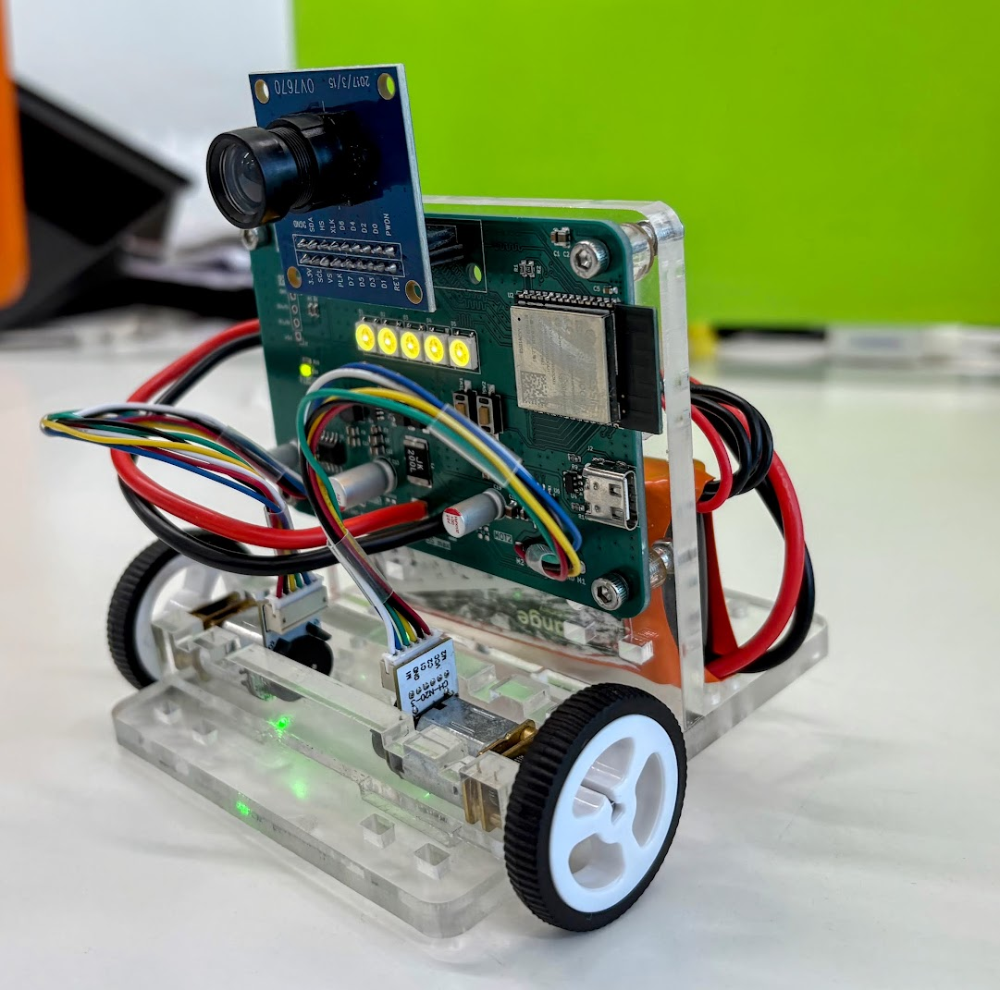

# camRover

camRover is an ESP32-S3 rover platform with an OV7670 camera, two encoder-equipped DC motors, and addressable RGB LEDs. This repository contains the KiCad hardware design, release manufacturing files, and Arduino firmware used to bring up and test the board.

## Repository contents

- [`board_bringup/`](board_bringup/) — Arduino ESP32-S3 firmware for camera streaming over Wi-Fi and testing motors, quadrature encoders, and LEDs.
- [`camRover_pcb/camRover_pcb_v1_1/`](camRover_pcb/camRover_pcb_v1_1/) — KiCad v1.1 project, hierarchical schematics, PCB layout, assembly files, stencil outputs, and release Gerbers/drill files.
- [`camrover_img.jpg`](camrover_img.jpg) — photo of the built rover.

## Board bring-up firmware

The sketch captures OV7670 RGB565 frames at QVGA (320 × 240), converts them to JPEG, and serves a browser-based test page. The page shows the live video and provides motor pulses, encoder tests, and RGB LED controls. Motor commands have a 2-second firmware watchdog.

### Build with Arduino IDE

Build tested with **Arduino-ESP32 3.3.12**.

1. Open `board_bringup/board_bringup.ino` in Arduino IDE. Keep `sccb_ov7670_compat.cpp` in the same sketch folder.
2. Install/select the **Arduino-ESP32 3.3.12** board package.
3. Select **ESP32S3 Dev Module** and set:

   | Setting | Value |
   |---|---|
   | Flash Size | `16MB (128Mb)` |
   | PSRAM | `OPI PSRAM` |
   | USB CDC On Boot | `Enabled` |

4. Connect the ESP32-S3 board over USB, select its port, then compile and upload.
5. Open Serial Monitor at **115200 baud**. After Wi-Fi connects, open the printed IP address in a browser.

Before uploading, set `WIFI_SSID` and `WIFI_PASSWORD` near the top of `board_bringup.ino` to your 2.4 GHz Wi-Fi credentials. The defaults in the sketch are local development settings; replace them for your network. The rover and browser must be on the same network. If Wi-Fi does not connect, motor and LED serial commands remain available.

Camera orientation and left-edge crop can be adjusted with `CAMERA_ROTATION` (`0`, `90`, `180`, or `270`) and `CAMERA_CROP_LEFT` in the sketch.

### Bring-up controls

The web page provides:

- Live OV7670 video.
- Forward/reverse pulse tests for each motor and both motors together; each web pulse lasts 750 ms.
- Encoder count reset and forward/reverse tests. Lift wheels clear before running encoder tests.
- Red, green, blue, white, and off LED controls.

Serial commands at 115200 baud:

| Command | Action |
|---|---|
| `m <left> <right>` | Drive motors with values from `-255` to `255` (1-second timeout). |
| `s` | Stop motors. |
| `l <r> <g> <b>` | Set all five LEDs; each color value is `0`–`255`. |
| `e` | Print encoder counts. |

### Firmware pin map

| Function | ESP32-S3 GPIO |
|---|---|
| OV7670 D0–D7 | 4, 8, 5, 9, 6, 10, 7, 11 |
| OV7670 XCLK / PCLK / VSYNC / HREF | 13 / 12 / 21 / 14 |
| OV7670 SIOD / SIOC | 16 / 17 |
| Motor 1 DRV8871 IN1 / IN2 | 18 / 15 |
| Motor 2 DRV8871 IN1 / IN2 | 42 / 47 |
| Motor 1 encoder A / B | 41 / 40 |
| Motor 2 encoder A / B | 2 / 1 |
| WS2812B chain DIN (5 LEDs) | 48 |

## PCB files

Open `camRover_pcb/camRover_pcb_v1_1/camRover_pcb_v1_1.kicad_pro` in KiCad. The project includes the main schematic and hierarchical sheets for the ESP32, motor drive, and power circuitry, plus the PCB layout and assembly bill of materials.

The `CamRover_v1_1_Gerbers/` folder and `CamRover_v1_1_Gerbers.zip` contain the release copper, solder mask, paste, silkscreen, board outline, drill files, and drill maps for fabrication. Check the fabrication house’s layer and drill requirements before ordering.
